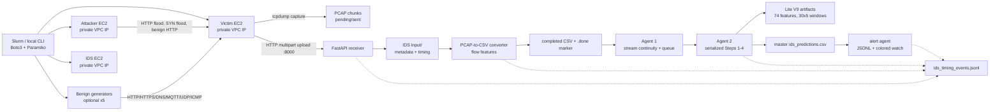

# AWS IDS Testbed 11 — Technical Report

**Project:** AWS IDS Testbed 11  
**Repository:** `/usagers3/sanazb/Projects/AWS_IDS_TestBed/aws_ids_testbed_11`  
**Prepared:** October 2026  
**Document status:** Technical description of the source tree, bundled model artifacts, and the implemented AWS workflow

> **Scope and evidence note.** This report describes what is implemented in the V11 source tree and its saved artifacts. It distinguishes the current 34-class Lite V9 runtime contract from historical five-class evaluation numbers preserved in `Lite_V9_CICIoT2023/improvemnet.md`. Historical numbers are not presented as a new V11 benchmark. The AWS run-time metrics are recorded by the system, but they must be regenerated for a particular experiment before being reported as a measured result.

## 1. Executive Summary

AWS IDS Testbed 11 is a reproducible cloud laboratory for generating controlled network traffic, capturing it as PCAP files, converting the captures into flow-level CSV features, and diagnosing the resulting windows with a compact Transformer classifier. A Slurm-hosted command-line interface provisions and controls EC2 instances. The laboratory separates public SSH control addresses from private VPC traffic addresses so that traffic generation, packet capture, and IDS analysis remain inside the AWS network.

The system has three principal instances: a victim, an attacker, and an IDS. Five optional benign-generator instances provide HTTP, HTTPS, DNS, MQTT, UDP, and ICMP telemetry. The victim continuously rotates captures, uploads completed PCAP files to a FastAPI receiver on the IDS, and the IDS converter extracts flow features. Two independent IDS agents then provide a continuous stream interface: Agent 1 preserves chronological continuity across CSV chunks and publishes queue jobs, while Agent 2 serially executes the existing four inference steps for one queued job at a time. Successful window predictions are appended to a persistent master CSV and converted into structured alert events.

The deployed model is the saved `LiteTransformerEncoderClassifier` from the bundled `Lite_V9_CICIoT2023` artifacts. Its runtime contract is 74 selected features, 30-flow windows, stride 5, 34 output classes, three efficient encoder layers, four attention heads, and a short-range convolution branch. The runtime uses the training scaler, selected-feature list, label classes, window configuration, and checkpoint together; these artifacts are treated as one versioned contract.

Key engineering outcomes are:

- a Slurm-to-EC2 lifecycle for creating, configuring, deploying, starting, stopping, and terminating the lab;
- continuous PCAP capture and safe upload/conversion markers;
- cross-file flow buffering so a CSV with fewer than 30 flows can be combined with subsequent traffic;
- explicit queue/state markers, one active inference transaction, one retry, and persistent predictions;
- per-window alerts with UTC and local timestamps;
- timing events and generated CSV reports for capture, transfer, conversion, queue, inference, model, alert, and end-to-end latency;
- scenario-level metrics for the current execution: accuracy, target-class precision, and target-class recall.

The project is an experimental testbed rather than a production security appliance. Before trusting a new experiment, the review findings concerning final capture draining, queue recovery, run isolation, converter direction counters, and completion validation should be addressed or explicitly accepted.

## 2. Introduction

### 2.1 Problem

Internet-of-Things (IoT) and cloud-connected services expose heterogeneous protocols and devices to scanning, denial-of-service, exploitation, and malware activity. An intrusion detection system (IDS) must transform high-volume packet traffic into stable features and classify behavior quickly enough to support an operational response. Offline model metrics alone do not demonstrate that the surrounding capture, transport, conversion, buffering, and alert pipeline behaves correctly.

This project therefore treats detection as an end-to-end system problem. It tests both the classifier and the operational path that feeds the classifier:

`traffic generation -> packet capture -> upload -> flow extraction -> continuous windowing -> inference -> alert -> measurement`.

### 2.2 Objectives

The objectives of V11 are to:

1. provision an isolated AWS VPC laboratory from a Slurm/local CLI;
2. run repeatable benign and attack scenarios with explicit parameters;
3. preserve capture order without waiting for missing or delayed files;
4. keep model inference compatible with the validated Lite V9 artifacts;
5. process CSV chunks as one continuous stream across PCAP rotations;
6. record predictions, alerts, and timing events for later audit;
7. make the existing local Slurm four-step inference workflow reusable on AWS;
8. expose limitations and failure states rather than hiding them behind a successful upload message.

### 2.3 Security and reproducibility principles

Traffic between the lab machines uses private VPC addresses. Public addresses are used for SSH control from Slurm. Scenario labels are ground truth metadata for assessment only; they are not passed to the model as a prediction instruction. All timestamps are stored in UTC ISO-8601 form, with a local human-readable timestamp added to alert events. Model artifacts and runtime dependencies are pinned as far as practical, including `scikit-learn==1.7.2`, because the scaler and serialized preprocessing objects must remain compatible.

## 3. System Architecture

### 3.1 Deployment topology

The default `config.yaml` uses AWS region `us-east-1`, a configured subnet and security group, Ubuntu SSH user `ubuntu`, `t3.micro` instances for the victim, attacker, and benign generators, and a `t3.small` instance for the IDS. The exact AMI, subnet, and security-group identifiers are configuration values and should be treated as environment-specific rather than portable documentation.



### 3.2 Slurm/local control plane

`aws_ids_testbed_11.cli` is the orchestration entry point. It reads `config.yaml` and `inventory.yaml`, obtains public IP/DNS values, connects with Paramiko, and runs remote commands. EC2 lifecycle operations use the AWS SDK. The CLI deliberately keeps the existing local commands for direct four-step inference (`ids-run-inference-step1` through `ids-run-inference-step4`) while adding cloud deployment and streaming commands.

### 3.3 Victim capture and sender

The victim configuration is stored at `/opt/aws_ids_testbed/config/victim.env`. `continuous_capture_agent.sh` reads that file on each rotation, runs `tcpdump` on the configured interface, writes to a temporary file, checks the minimum size, and moves a completed capture into `/opt/aws_ids_testbed/pcap/pending`. `pending_pcap_sender_agent.sh` uploads pending PCAPs to the IDS and moves successful uploads to `pcap/sent`. A sidecar timing record travels with the upload so capture start/end and upload start can be correlated later.

The capture filter excludes the IDS control port and SSH port by default. This prevents management traffic from dominating the learned flow distribution.

### 3.4 IDS receiver

`ids_receiver_app.py` exposes:

- `GET /health` for readiness checks;
- `POST /upload-pcap` for multipart PCAP upload and metadata.

The receiver assigns/records capture metadata, computes SHA-256, writes the file atomically into `/home/ubuntu/aws_ids_testbed/input`, and emits a `pcap_received` timing event. The current implementation relies on the private-network security group and does not yet provide an application upload token, comprehensive content inspection, or a hard maximum upload size. Those are hardening tasks, not assumptions of the current design.

### 3.5 Converter and inference agents

The converter watches the IDS input directory and invokes the deployed `ids_pcap_to_csv/pcap2csv/Generating_dataset.py` pipeline. The converter splits large captures, extracts packet/flow features, merges sub-CSV files, removes temporary pieces, and records a `.pcap.done` marker under the converter state directory.

Agent 1 (`ids_input_agent.py`) consumes only completed conversions. It orders source CSVs by IDS receipt order, combines each file with the continuity tail from preceding files, and requires at least 30 combined rows before publishing a queue job. It keeps the final tail needed for a stride-5 sliding window and can continue preparing CSV2 while Agent 2 processes CSV1.

Agent 2 (`ids_inference_agent.py`) claims the smallest queue sequence, copies the queued CSV into the existing four-step input contract, and runs the unchanged pipeline. A single active transaction is allowed. A normal failure is retried once; after a second failure the job is marked failed and processing continues. Successful outputs are appended to the persistent master prediction file.

### 3.6 Alert and timing paths

`ids_alert_agent.py` watches the master predictions and writes one JSON object per window to `logs/ids_alert_events.jsonl`. The interactive `ids-watch-alerts` command colors benign events green, attack events red, and unknown/low-confidence events yellow. Background logs remain plain text/JSONL.

The central timing event log is `/home/ubuntu/aws_ids_testbed/logs/ids_timing_events.jsonl`. Final reports are generated on the IDS and downloaded to local `artifacts/ids_timing/`; predictions are downloaded to `artifacts/ids_inference/ids_predictions.csv`.

## 4. Dataset and Preprocessing

### 4.1 CICIoT2023

CICIoT2023 is a large IoT network-traffic dataset and benchmark containing benign activity and multiple attack families across realistic IoT devices and protocols. The bundled configuration points to labeled CSV groups under `Data/CICIoT2023/CSV_files_with_labels` and is configured to use all configured CSV groups. The source groups include DNS, LDAP, MSSQL, NTP, NetBIOS, SNMP, SSDP, UDP, SYN, TFTP, UDPLag, and related attack families.

The dataset is used for model development; live AWS traffic is converted to the same feature schema and is not assumed to contain a label. Scenario names are recorded as declared ground truth for testbed assessment only.

### 4.2 Feature preparation

The training/preprocessing configuration performs the following operations:

1. load labeled flow CSVs and normalize label names;
2. remove identifiers and non-model fields such as source/destination IP, flow ID, duplicate index fields, and raw timestamp columns;
3. split data in a leakage-aware fashion, with chronological and file-boundary controls where configured;
4. fit feature selection and `StandardScaler` on the training portion;
5. transform validation/test/live data with the saved training artifacts;
6. create windows of 30 rows with stride 5;
7. save the selected feature order, scaler, class order, and window configuration beside the checkpoint.

The current runtime artifact contains 74 selected features. The runtime removes `min_duration`, `max_duration`, `average_duration`, `sum_duration`, and `idle_time` to the scaler mean when diagnostic time-leakage neutralization is enabled. This makes the scaled values zero for those fields and avoids relying on absolute timestamp values during live diagnosis. It is a diagnostic mitigation and should be reported with every experiment because it changes the live preprocessing contract relative to raw extraction.

### 4.3 Continuous-stream preprocessing

The AWS converter emits independent CSV files, but the inference model consumes sliding windows. Agent 1 therefore maintains a stream buffer. If CSV1 has 30 rows and CSV2 has 20, the next combined job uses the appropriate tail from CSV1 plus CSV2, then retains the tail required for the following job. The process does not wait for an absent sequence number: receipt order is the order of diagnosis. A source file is removed from the ready queue when it is claimed, while the continuity buffer is persisted separately.

### 4.4 Preprocessing artifacts

The principal saved artifacts are:

| Artifact | Purpose |
| --- | --- |
| `selected_features.pkl` | Exact ordered 74-feature input contract |
| `standard_scaler.pkl` | Training-fitted standardization |
| `label_classes.pkl` | 34 class names and label order |
| `window_config.pkl` | Best window and step (`30`, `5`) |
| `model_config.json` | Network shape and hyperparameters |
| `best_model.pt` | Trained PyTorch checkpoint |

## 5. Proposed Model

### 5.1 Implemented model: efficient Transformer encoder classifier

The deployed model is `LiteTransformerEncoderClassifier`. An input tensor has shape `(batch, 30, 74)`. A linear feature embedding maps 74 features to `d_model=64`. Positional information and dropout are applied before three lightweight encoder layers.

Each `LiteEncoderLayer` divides the hidden representation between:

- a long-range branch using multi-head self-attention (`4` heads), and
- a short-range branch using depthwise/lightweight temporal convolution (`2` convolutional layers, kernel size `5`).

The branches are concatenated (`fusion_type="concat"`), projected, added through residual connections, normalized, and passed through a GELU feed-forward block with width `d_ff=384`. Mean pooling over the 30-flow sequence produces a fixed-size representation. The classifier head is a dropout-regularized MLP ending in 34 logits.

This design combines global context with local burst/sequence structure at lower memory and compute cost than a full Transformer stack. It is suitable for CPU inference on the IDS `t3.small` during the current testbed experiments.

### 5.2 Autoencoder clarification

The V11 source tree does **not** contain a separate autoencoder module, reconstruction-loss stage, or autoencoder checkpoint in the active AWS inference path. The encoder in `LiteTransformerEncoderClassifier` is a representation-learning component inside a supervised classifier; it is not an autoencoder because it does not reconstruct the input.

An autoencoder can be added as a future hybrid option: an encoder would map each flow window to a compact latent representation, a decoder would reconstruct normal traffic, and reconstruction error could be fused with the classifier logits for anomaly scoring. That would require a new training objective and new validated artifacts. It is not used by the results or commands documented in this report.

### 5.3 Classifier outputs

The final linear layer produces one logit for each saved class. Softmax probabilities provide a predicted label and confidence. The alert agent maps `Benign_Final` to a benign verdict and treats other predicted classes as attack verdicts. Scenario metrics use the expected label associated with the scenario name; that label is never supplied to the model during prediction.

## 6. Model Training and Optimization

### 6.1 Training pipeline

The training project performs leakage-aware splitting, feature selection, scaling, window creation, label encoding, model training, checkpointing, and evaluation. Training arrays and diagnostic arrays are not required on the AWS IDS host; only the runtime model and preprocessing artifacts are deployed.

### 6.2 Hyperparameters in the saved contract

| Parameter | Value |
| --- | ---: |
| Window length | 30 flows |
| Step size | 5 flows |
| Input features | 74 |
| Output classes | 34 |
| Embedding/hidden width | 64 |
| Attention heads | 4 |
| Encoder layers | 3 |
| Feed-forward width | 384 |
| Dropout | 0.2 |
| Activation | GELU |
| Local branch | enabled |
| Convolution kernel | 5 |
| Convolution layers | 2 |
| Attention fraction | 0.5 |
| Training batch size | 64 (configured) |
| Inference batch size | 64 |

The training configuration uses weighted cross-entropy for class imbalance, optional window-level SMOTE on training data, macro-F1-aware checkpoint selection, and early stopping. The AWS inference path does not retrain or tune the model.

### 6.3 Version history and reproducibility

The repository contains historical Lite V9/V6 documentation and compatibility names (`LITE_V6_*`) in the detector configuration, but the active values point to `Lite_V9_CICIoT2023/outputs`. This naming is maintained for code compatibility. A reproducible experiment must record the commit, model checksum, selected-feature checksum, scaler checksum, Python dependencies, and scenario parameters together.

## 7. Experimental Setup

### 7.1 Hardware and AWS resources

The configured laboratory uses:

- Slurm/local workstation: Python CLI, AWS credentials, SSH private key, and experiment operator terminal;
- victim: AWS EC2 `t3.micro`;
- attacker: AWS EC2 `t3.micro`;
- IDS: AWS EC2 `t3.small`;
- five optional benign generators: AWS EC2 `t3.micro` each.

The IDS instance is intentionally larger than the traffic endpoints because it runs the receiver, converter, model runtime, queue agents, alert agent, and report generation concurrently. The exact performance depends on AWS host load, storage, capture rate, and network conditions.

### 7.2 Software

The runtime dependency file pins FastAPI, Uvicorn, multipart upload support, NumPy, pandas, SciPy, scikit-learn 1.7.2, joblib, dpkt, Scapy, and tqdm. PyTorch CPU is installed in the IDS inference environment. The project uses Bash, `tcpdump`, `curl`, Paramiko, Boto3, and system utilities such as `ss`, `find`, and `sha256sum`.

### 7.3 Experiment controls

Each run has a generated `scenario_execution_id`. Scenario input completion is marked by:

`state/scenario_runs/<execution_id>.end.json`.

When the input queue drains and the quiet period expires, the inference agent writes:

`state/scenario_runs/<execution_id>.complete.json`.

The default quiet period is 120 seconds. This is separate from the scenario's capture hold time and from the traffic-generation duration.

## 8. Model Evaluation Results

### 8.1 Current V11 evaluation status

V11 stores a 34-class saved model contract, but this repository does not contain a new, independently generated 34-class held-out test report or confusion matrix for the current artifacts. AWS scenario runs produce predictions and scenario-level metrics after downloading the current execution's prediction CSV. Those metrics are recorded in:

`artifacts/ids_inference/ids_metrics.jsonl`.

For each execution, the current metric writer records:

- `accuracy`;
- `precision_for_ground_truth_class`;
- `recall_for_ground_truth_class`.

The scenario ground-truth mapping is `benign_http -> Benign_Final`, `benign_iot_5_generators -> Benign_Final`, `dos_http_flood -> DoS-HTTP_Flood`, and `dos_syn_flood -> DoS-SYN_Flood`. The metrics filter by the current `scenario_execution_id`, preventing older master-prediction rows from being counted in the new run.

### 8.2 Historical baseline preserved in the repository

`Lite_V9_CICIoT2023/improvemnet.md` contains a historical five-class evaluation, associated with an earlier experiment and not the current 34-class AWS contract:

| Metric | Historical value |
| --- | ---: |
| Test accuracy | 0.925110 |
| Weighted precision | 0.958994 |
| Weighted recall | 0.925110 |
| Weighted F1 | 0.934880 |
| Macro precision | 0.852109 |
| Macro recall | 0.961176 |
| Macro F1 | 0.883356 |
| Balanced accuracy | 0.961176 |

The same document reports a best validation accuracy of 0.879240, validation macro-F1 of 0.876927, and balanced accuracy of 0.948946. The historical five-class confusion matrix was:

```text
[[2852,    0,   4, 391, 42],
 [  25, 2117,  14,   0,  0],
 [   9,    0, 502,   0,  0],
 [   0,    0,   4, 298,  0],
 [   0,    0,   0,   4, 321]]
```

The largest historical weakness was overprediction of one minority class: 391 true class-0 samples were assigned to class 3. This illustrates why macro-F1, per-class recall, and a confusion matrix are required in addition to accuracy.

### 8.3 Recommended V11 evaluation table

For a publishable V11 benchmark, regenerate the following from a held-out, labeled 34-class test set using the exact saved feature/scaler/window artifacts:

| Required result | Source |
| --- | --- |
| Accuracy | `sklearn.metrics.accuracy_score` |
| Macro precision | `precision_score(..., average="macro")` |
| Macro recall | `recall_score(..., average="macro")` |
| Macro F1 | `f1_score(..., average="macro")` |
| Weighted precision/recall/F1 | `average="weighted"` |
| Per-class precision/recall/F1 | `classification_report` |
| Confusion matrix | `confusion_matrix` plus saved label classes |

Until this is regenerated, the historical values must be labeled historical and the AWS values must be labeled scenario-specific.

## 9. AWS IDS Implementation

### 9.1 Deployment sequence

The normal deployment sequence is:

1. create or refresh EC2 instances and inventory;
2. run the victim, attacker, and IDS setup commands;
3. configure victim-to-IDS and attacker-to-victim private URLs;
4. deploy the receiver, capture agent, sender, converter, and inference runtime;
5. start the receiver, converter, input/inference agents, and alert agent;
6. run a scenario from Slurm;
7. wait for input completion and inference completion;
8. generate/download timing reports and prediction CSVs;
9. append current-execution metrics.

### 9.2 Four inference steps

Agent 2 calls the existing functions rather than duplicating model logic:

1. **Step 1 — Load:** read the queue CSV and write `step_1_Loaded_IDS_Data.pkl`.
2. **Step 2 — Preprocess:** clean/normalize columns and write `step_2_Processed_IDS_Data.pkl`.
3. **Step 3 — Features and windows:** select the saved 74 features, scale with the saved scaler, create 30-row/stride-5 windows, and write `X_IDS_windows.npy` plus metadata.
4. **Step 4 — Predict:** load the saved checkpoint, infer batches on CPU or available CUDA, and write `ids_predictions.csv` and the prediction summary.

The four-step pipeline remains available for direct local Slurm execution. The cloud agents supply isolated input/output paths and then append successful results to the shared master CSV.

### 9.3 Persistence paths

Important IDS paths are:

```text
/home/ubuntu/aws_ids_testbed/input/                     received PCAPs
/home/ubuntu/aws_ids_testbed/output/csv/                converted CSVs
/home/ubuntu/aws_ids_testbed/state/                     markers and run state
/home/ubuntu/aws_ids_testbed/inference/queue/            ready/active queue jobs
/home/ubuntu/aws_ids_testbed/inference/ids_predictions.csv
/home/ubuntu/aws_ids_testbed/logs/ids_alert_events.jsonl
/home/ubuntu/aws_ids_testbed/logs/ids_timing_events.jsonl
```

The local downloads are placed under `artifacts/ids_inference/` and `artifacts/ids_timing/`.

## 10. Attack and Benign Scenarios

### 10.1 Scenario 1 — benign HTTP profile

Scenario 1 uses the attacker-side benign HTTP profile and the common victim capture/sender path. It is useful for validating that ordinary web activity can traverse the same operational pipeline as attacks.

### 10.2 Scenario 2 — controlled HTTP flood

The attacker runs ApacheBench through `generate_traffic.sh`. The request count and concurrency are CLI parameters. A representative command is:

```bash
python -m aws_ids_testbed_11.cli run-scenario 2 \
  --requests 1000 \
  --concurrency 50 \
  --auto-stop-seconds 200
```

The victim sets `ACTIVE_SCENARIO=dos_http_flood`, starts capture and sender agents, receives traffic on its web service, and rotates PCAPs. After the attacker finishes, the capture remains open for the requested hold time so late packets can be included. The victim agents are stopped, pending uploads are drained, and IDS diagnosis continues until the scenario marker is complete.

### 10.3 Scenario 3 — controlled SYN flood

The attacker runs hping3 with a packet count and inter-packet interval:

```bash
python -m aws_ids_testbed_11.cli run-scenario 3 \
  --packet-count 1000 \
  --interval-microseconds 5000 \
  --auto-stop-seconds 200
```

The expected development label is `DoS-SYN_Flood`. This scenario exercises packet-rate and connection-establishment features rather than HTTP request semantics.

### 10.4 Scenario 4 — five-generator benign IoT traffic

Scenario 4 starts the five configured benign generators. Their profiles cover HTTPS, DNS/UDP telemetry, HTTP, MQTT, and ICMP/UDP heartbeat traffic. The traffic-generation duration is separate from the capture hold duration:

```bash
python -m aws_ids_testbed_11.cli run-scenario 4 \
  --traffic-duration-seconds 300 \
  --auto-stop-seconds 200
```

The operational capture label remains `benign_http` for compatibility with the victim capture path, while the metrics finalizer uses `benign_iot_5_generators` so the expected benign class is assigned correctly. The capture rotation is controlled by one `CAPTURE_ROTATE_SECONDS` value; each completed chunk follows the same receiver/converter/inference path as an attack scenario.

### 10.5 Ordering and missing packets

Packets and PCAPs are diagnosed in the order received by the IDS. Missing sequence numbers, delayed uploads, timestamp gaps, and out-of-order packet timestamps are informational conditions; the IDS does not block waiting for a missing capture. This is important for a live stream, where waiting indefinitely would increase detection latency.

## 11. Real-Time Performance Evaluation

### 11.1 Timing event model

The IDS records timing events centrally in `ids_timing_events.jsonl`. Events carry capture identifiers, scenario/execution context where available, UTC timestamps, and monotonic duration measurements. The reporting command creates:

- `ids_pcap_timing.csv` — one row per received/captured PCAP;
- `ids_transaction_timing.csv` — one row per queued inference transaction;
- `ids_window_timing.csv` — one row per predicted window.

### 11.2 Metrics and formulas

| Metric | Definition |
| --- | --- |
| PCAP capture duration | `capture_ended_at - capture_started_at` from victim sidecar metadata |
| PCAP transfer latency | IDS receive time minus upload/capture transfer start |
| PCAP conversion time | converter start to converter completion |
| Queue wait latency | `inference_started_at - queued_at` |
| Total inference duration | Agent 2 transaction start to successful/failed completion, including preparation and four steps |
| Pure model inference time | Sum of timed model batch execution only, excluding queue and preprocessing |
| Alert processing latency | alert recording time minus inference completion time |
| End-to-end detection latency | alert time minus capture start (or the closest recorded capture timestamp) |

The report generator preserves total inference and pure model inference separately. This avoids confusing a fast neural-network forward pass with the much larger queue, conversion, and file-processing delay that a live user experiences.

### 11.3 Interpreting the timing reports

Latency should be summarized with count, median, p95, maximum, and failure count for each scenario. A useful scenario comparison is:

```text
capture -> transfer -> conversion -> queue -> inference -> alert
```

The aggregate numbers must be calculated from the downloaded report for the specific `scenario_execution_id`; the persistent master prediction CSV and timing log intentionally retain previous executions. Do not mix old rows into a new scenario report.

### 11.4 Expected bottlenecks

The largest contributors are normally capture rotation and converter startup for small files, queue waiting when PCAPs arrive faster than inference, and the final quiet period after the `.end.json` marker. Pure model time is expected to be only a portion of end-to-end latency. The IDS `t3.small` should be monitored for memory pressure and CPU saturation when many windows or benign generators are active.

## 12. Discussion and Limitations

### 12.1 Strengths

- The model path is artifact-driven and reproducible: feature order, scaler, classes, window parameters, and checkpoint are explicit.
- The streaming buffer respects 30-row windows and stride-5 continuity across rotated CSV files.
- Agent 1 and Agent 2 run in parallel, reducing idle time between capture preparation and inference.
- The pipeline is observable through markers, logs, prediction CSVs, alert JSONL, and timing CSVs.
- Scenario metadata and predicted labels remain separate, preventing declared ground truth from controlling model output.

### 12.2 Current technical limitations

The source review identified issues that should be treated as release risks:

1. **Final capture drain:** stopping the capture shell can strand a final `tcpdump` child or temporary PCAP unless shutdown is coordinated and waited for.
2. **Queue publication atomicity:** if Agent 1 fails after advancing its continuity buffer but before durable publication, rows can be lost or repeated.
3. **Restart recovery:** an active Agent 2 marker can remain after interruption and prevent subsequent jobs from being claimed.
4. **Cross-run isolation:** queued jobs do not yet carry an immutable originating execution ID in every path; stale work can be attributed to a later run.
5. **Converter direction fields:** endpoint normalization and reverse-key lookup can make forward/reverse packet counters incorrect. These are model input features and should be validated against bidirectional captures.
6. **Completion validation:** a completion marker and a nonempty cumulative prediction CSV do not by themselves prove that the current execution succeeded without conversion/inference failures.
7. **Absolute timestamp-derived features:** several duration statistics are historically computed from epoch timestamps. Live neutralization avoids the largest leakage effect but makes the live input distribution differ from raw training extraction.
8. **Security hardening:** the receiver currently depends primarily on private-network access; token authentication, strict file validation, upload-size limits, and retention policies remain necessary for broader deployment.
9. **Resource limits:** the small IDS instance has finite CPU, memory, disk, and network capacity. Long scenarios can accumulate PCAPs, CSVs, queue files, logs, and predictions.
10. **Evaluation gap:** the current tree has no new 34-class held-out confusion matrix. Historical five-class results must not be substituted for a current V11 benchmark.

### 12.3 Operational interpretation

The system is designed to continue diagnosing available traffic rather than block on missing packets. That choice improves liveness but means that an experiment must record gaps and delayed uploads as quality metadata. A successful diagnosis is therefore a statement about the received stream, not a guarantee that every generated packet was captured or uploaded.

## 13. Conclusion and Future Work

V11 integrates controlled traffic generation, distributed capture, cloud-side feature extraction, continuous flow windowing, efficient Transformer inference, alerting, and timing measurement into one reproducible AWS IDS testbed. The design preserves the existing four-step model interface while adding the runtime components needed for a continuously operating IDS. It also makes an important distinction between model execution time and the complete user-visible detection delay.

Recommended next steps are:

1. make capture shutdown transactional and verify the final PCAP for the current execution;
2. add immutable execution IDs to receiver, converter, queue, prediction, and alert records;
3. implement startup recovery and idempotent replay for queue jobs;
4. correct and regression-test directional packet counters before retraining or trusting affected features;
5. add receiver authentication, content/size validation, disk quotas, and log rotation;
6. regenerate a held-out 34-class evaluation with a confusion matrix and publish checksums for every artifact;
7. add automated p50/p95/p99 timing summaries and capacity tests on the target EC2 size;
8. evaluate an optional autoencoder-assisted anomaly score as a separate, versioned experiment rather than silently changing the classifier;
9. replace ad-hoc `nohup` processes with systemd units when persistent service supervision is required;
10. add acceptance tests that restart each agent during capture, conversion, queue publication, and inference.

## 14. References

1. Pinto Neto, E. C., et al. “CICIoT2023: A Real-Time Dataset and Benchmark for Large-Scale Attacks in IoT Environment.” *Sensors*, 2023, 23(13), 5941. [https://doi.org/10.3390/s23135941](https://doi.org/10.3390/s23135941)
2. Vaswani, A., et al. “Attention Is All You Need.” arXiv:1706.03762. [https://arxiv.org/abs/1706.03762](https://arxiv.org/abs/1706.03762)
3. PyTorch documentation, `torch.nn.MultiheadAttention`. [https://docs.pytorch.org/docs/stable/generated/torch.nn.MultiheadAttention.html](https://docs.pytorch.org/docs/stable/generated/torch.nn.MultiheadAttention.html)
4. Amazon Web Services, Amazon EC2 documentation. [https://docs.aws.amazon.com/ec2/](https://docs.aws.amazon.com/ec2/)
5. FastAPI documentation. [https://fastapi.tiangolo.com/](https://fastapi.tiangolo.com/)
6. Uvicorn documentation. [https://www.uvicorn.org/](https://www.uvicorn.org/)
7. scikit-learn model evaluation documentation. [https://scikit-learn.org/stable/modules/model_evaluation.html](https://scikit-learn.org/stable/modules/model_evaluation.html)
8. Project-local implementation and experiment records:
   - `ProjectProgress.md`
   - `ReportSpeech.md`
   - `Lite_V9_CICIoT2023/README.md`
   - `Lite_V9_CICIoT2023/improvemnet.md`
   - `docs/PROJECT_REVIEW_2026-10-26.md`
   - `aws_ids_testbed_11/ids_detector/lite_v6/config/config.py`
   - `Lite_V9_CICIoT2023/outputs/models/model_config.json`

## 15. Appendices

### Appendix A — Representative CLI workflow

Run commands from the V11 project root after activating the environment:

```bash
cd /usagers3/sanazb/Projects/AWS_IDS_TestBed/aws_ids_testbed_11
source env_aws_ids/bin/activate

# Inventory and lifecycle
python -m aws_ids_testbed_11.cli show-inventory
python -m aws_ids_testbed_11.cli refresh-victim
python -m aws_ids_testbed_11.cli refresh-attacker
python -m aws_ids_testbed_11.cli refresh-ids

# Deployment (representative)
python -m aws_ids_testbed_11.cli deploy-ids-receiver
python -m aws_ids_testbed_11.cli deploy-ids-pcap-converter
python -m aws_ids_testbed_11.cli deploy-ids-inference-runtime
python -m aws_ids_testbed_11.cli deploy-victim-capture-agent
python -m aws_ids_testbed_11.cli deploy-victim-sender-agent

# Start the IDS-side services
python -m aws_ids_testbed_11.cli ids-start-receiver
python -m aws_ids_testbed_11.cli ids-start-pcap-converter-agent
python -m aws_ids_testbed_11.cli ids-start-inference-agents
python -m aws_ids_testbed_11.cli ids-start-alert-agent

# Attack scenarios
python -m aws_ids_testbed_11.cli run-scenario 2 --requests 1000 --concurrency 50 --auto-stop-seconds 200
python -m aws_ids_testbed_11.cli run-scenario 3 --packet-count 1000 --interval-microseconds 5000 --auto-stop-seconds 200

# Five-generator benign scenario
python -m aws_ids_testbed_11.cli run-scenario 4 --traffic-duration-seconds 300 --auto-stop-seconds 200

# Interactive alerts and reports
python -m aws_ids_testbed_11.cli ids-watch-alerts
python -m aws_ids_testbed_11.cli ids-generate-timing-reports --execution-id EXECUTION_ID
python -m aws_ids_testbed_11.cli ids-download-timing-reports
```

The exact optional arguments can be inspected with `python -m aws_ids_testbed_11.cli --help`.

### Appendix B — Local four-step inference

The original Slurm inference interface remains available:

```bash
python -m aws_ids_testbed_11.cli ids-run-inference-step1 --input-directory artifacts/ids_csv
python -m aws_ids_testbed_11.cli ids-run-inference-step2
python -m aws_ids_testbed_11.cli ids-run-inference-step3
python -m aws_ids_testbed_11.cli ids-run-inference-step4
```

These commands use the configured local artifact directory and are independent of the AWS agents. The cloud agents call the same underlying pipeline functions with an isolated per-transaction workspace.

### Appendix C — Configuration excerpt

```yaml
lab_name: aws-ids-testbed
aws_region: us-east-1
ssh:
  username: ubuntu
aws:
  key_name: aws-ids-testbed-key
  security_group_id: <environment-specific>
  subnet_id: <environment-specific>
instances:
  victim: {instance_type: t3.micro}
  attacker: {instance_type: t3.micro}
  ids: {instance_type: t3.small}
```

Victim runtime settings are stored remotely in `/opt/aws_ids_testbed/config/victim.env`; the important capture setting is the single `CAPTURE_ROTATE_SECONDS` value. IDS runtime paths and model artifact paths are defined in `ids_detector/lite_v6/config/config.py` and resolved to the bundled Lite V9 outputs.

### Appendix D — Representative event records

PCAP receipt timing event (fields vary with metadata availability):

```json
{
  "event_type": "pcap_received",
  "capture_id": "dos_http_flood_000120",
  "declared_scenario": "dos_http_flood",
  "received_at_utc": "2026-10-24T14:40:30Z",
  "sha256": "..."
}
```

Alert event exposed to the monitor:

```json
{
  "scenario": "dos_http_flood",
  "inference_csv_name": "dos_http_flood_000120_inference.csv",
  "window_index": 0,
  "predicted_label_name": "DoS-HTTP_Flood",
  "confidence": 0.98,
  "verdict": "ATTACK",
  "detected_at_utc": "2026-10-24T14:40:32Z",
  "detected_at_local": "October 24, 2026 at 10:40:32 AM"
}
```

Timing report fields include `queued_at_utc`, `inference_started_at_utc`, `inference_completed_at_utc`, `queue_wait_duration_ms`, `total_inference_duration_ms`, `pure_model_inference_duration_ms`, `alert_recorded_at_utc`, `inference_to_alert_latency_ms`, and `end_to_end_detection_latency_ms`.

### Appendix E — Operational checks

```bash
# On the IDS instance
tail -F /home/ubuntu/aws_ids_testbed/logs/ids_input_agent.log \
        /home/ubuntu/aws_ids_testbed/logs/ids_inference_agent.log \
        /home/ubuntu/aws_ids_testbed/logs/ids_alert_agent.log

# List scenario markers
ls -lt /home/ubuntu/aws_ids_testbed/state/scenario_runs/*.end.json
ls -lt /home/ubuntu/aws_ids_testbed/state/scenario_runs/*.complete.json

# Check process PID files
for agent in ids_input_agent ids_inference_agent ids_alert_agent; do
  pid_file=/home/ubuntu/aws_ids_testbed/$agent.pid
  if [ -f "$pid_file" ] && kill -0 "$(cat "$pid_file")" 2>/dev/null; then
    echo "$agent running: $(cat "$pid_file")"
  else
    echo "$agent stopped"
  fi
done
```

### Appendix F — Reporting checklist

For every publishable experiment, retain:

- the `scenario_execution_id`;
- scenario parameters and start/end times;
- model/checkpoint/scaler/feature checksums;
- received, converted, queued, completed, failed, and alert counts;
- timing CSVs and the prediction CSV;
- current-execution accuracy, target precision, and target recall;
- the exact source commit and dependency versions;
- any missing packet, delayed upload, converter, inference, or alert warnings.

This checklist makes it possible to distinguish a model error from a capture, transport, conversion, queue, or monitoring failure.
